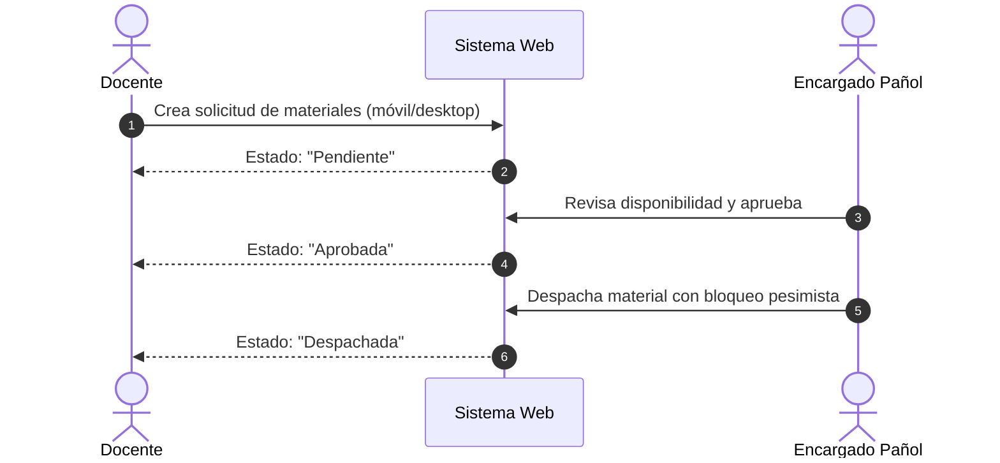

# Manual de Usuario del Sistema de Gestión de Pañol
**Institución:** INACAP Sede Temuco — Área de Informática y Telecomunicaciones  
**Sistema:** Aplicación Web de Gestión de Equipos, Insumos y Préstamos de Pañol  
**Versión:** 1.0.0 (Producción)  
**Fecha de Emisión:** Octubre 2026  

---

## 1. Introducción y Propósito del Sistema

El **Sistema de Gestión de Pañol** es una plataforma web monolítica modular desarrollada bajo el stack institucional (PHP 8.3 + Laravel 11, Livewire 3, Tailwind CSS y PostgreSQL 18). Su propósito operativo es centralizar, auditar y agilizar la administración del inventario de insumos, equipos computacionales, laboratorios de redes, solicitudes de préstamo docente, compras con cotización asistida por OCR y control presupuestario de las carreras adscritas.

### 1.1 Perfiles de Usuario y Matriz de Acceso
El sistema implementa control de acceso basado en roles (RBAC) validado estrictamente en servidor:

| Perfil | Alcance y Responsabilidades Principales | Rutas Principales |
| :--- | :--- | :--- |
| **Administrador** | Gestión de carreras, usuarios, asignación de presupuestos anuales, aprobación de excepciones de compra, supervisión de inventario consolidado, auditoría de fallas y ejecución de respaldos DRP. | `/admin/dashboard`, `/admin/presupuestos`, `/admin/carreras`, `/admin/usuarios` |
| **Encargado de Pañol** | Control de existencias, escaneo de códigos de barras, ingreso de compras con validación asistida por OCR, entrega/devolución de materiales a docentes y estudiantes, registro de bajas técnicas y ejecución de mantenimientos preventivos. | `/panol/dashboard`, `/panol/inventario`, `/panol/compras`, `/panol/entregas`, `/panol/mantenimientos` |
| **Docente** | Consulta de catálogo institucional en tiempo real, solicitud de materiales y equipos para talleres y laboratorios (interfaz responsive para móviles y escritorio), seguimiento del estado de solicitudes y reporte ágil de fallas con fotografías. | `/docente/solicitudes`, `/docente/fallas`, `/docente/catalogo` |

> [!NOTE]
> **Alumnos de la Sede:** Los estudiantes no poseen credenciales de inicio de sesión ni cuentas de usuario. La entrega de materiales a estudiantes se registra únicamente bajo la modalidad de recepción presencial supervisada dentro de la tabla `entregas`, capturando RUT y nombre institucional.

---

## 2. Acceso y Autenticación al Sistema

### 2.1 Inicio de Sesión (`/login`)
1. Ingrese a la URL institucional del sistema (ej. `http://panol.inacap.cl/login`).
2. Introduzca su correo electrónico institucional (`@inacap.cl` o `@inacapmail.cl`) y contraseña asignada.
3. El sistema valida las credenciales y el estado activo del usuario. Si el usuario está inactivo, el acceso será rechazado de forma segura.
4. Una vez autenticado, el middleware redirige automáticamente al panel principal correspondiente a su rol.

```
+--------------------------------------------------------------+
|                     INACAP SEDE TEMUCO                       |
|           Sistema de Gestión de Pañol y Laboratorios         |
+--------------------------------------------------------------+
| Correo Institucional: [ docente.ejemplo@inacap.cl          ] |
| Contraseña:           [ ******************                 ] |
|                                                              |
|                     [ Iniciar Sesión ]                       |
+--------------------------------------------------------------+
```

---

## 3. Módulo de Docente

El módulo docente está diseñado con una interfaz adaptable optimizada tanto para teléfonos inteligentes como para estaciones de laboratorio (SLA-02, PI-07).

### 3.1 Consulta de Catálogo y Disponibilidad (`/docente/catalogo`)
* Permite buscar insumos y equipos en tiempo real mediante filtros por nombre, categoría, marca o ubicación.
* Muestra el estado operativo del equipo (`disponible`, `prestado`, `en_mantenimiento`, `baja`) y el stock actual de insumos fungibles.

### 3.2 Solicitud de Préstamo de Materiales (`/docente/solicitudes`)
Para solicitar equipos o insumos para clases prácticas de taller o cátedra:
1. Navegue a **Solicitudes > Nueva Solicitud**.
2. Complete los datos de contexto académico:
   * **Carrera asociada:** (ej. Ingeniería en Informática).
   * **Asignatura / Taller:** (ej. Redes de Área Amplia).
   * **Fecha y Bloque de Uso:** Día y bloque horario requerido.
3. Añada los ítems requeridos indicando cantidad solicitada y observaciones pedagógicas.
4. Presione **Enviar Solicitud**.
5. La solicitud ingresará en estado `pendiente`. El docente puede supervisar el avance de aprobación en la misma pantalla:
   * 🟡 `Pendiente`: Esperando revisión en pañol.
   * 🟢 `Aprobada`: Preparada para retiro en pañol.
   * 🔵 `Despachada`: Material retirado y en uso en laboratorio.
   * 🔴 `Rechazada`: Con justificación técnica del pañolero.



### 3.3 Reporte de Fallas de Equipamiento (`/docente/fallas`)
Si un equipo presenta defectos operativos durante una sesión práctica:
1. Ingrese a **Reportar Falla**.
2. Seleccione el equipo desde el listado o escanee su código de barras.
3. Describa la anomalía observada (ej. *"Puerto Gigabit 1 no negocia enlace dúplex"*).
4. *(Opcional)* Adjunte una fotografía del síntoma o daño físico (PNG/JPG máx. 5 MB).
5. Haga clic en **Registrar Reporte de Falla**. El equipo se marcará con advertencia y se notificará al pañol para diagnóstico.

---

## 4. Módulo de Encargado de Pañol

El encargado de pañol gestiona el ciclo operativo de inventario, despachos físicos, recepción de compras y mantenimiento.

### 4.1 Catálogo de Inventario y Códigos de Barras (`/panol/inventario`)
* **Búsqueda por Lector Láser/Óptico:** Al hacer foco en el buscador y disparar la pistola de código de barras, el sistema recupera la ficha del ítem en menos de 1 segundo.
* **Impresión de Etiquetas de Código de Barras (SLA-07):**
  1. Seleccione los equipos o insumos a etiquetar.
  2. Presione **Generar Lote de Etiquetas**.
  3. El sistema renderiza un documento listo para impresión térmica en formato Code 128 descriptivo institucional (con código, carrera y nombre) en $\le 10$ segundos para lotes de hasta 20 unidades.

### 4.2 Proceso de Compras y Reconocimiento Documental Asistido por OCR (`/panol/compras`)
Cumple estrictamente con el **BPMN Proceso 1 y Proceso 2**:
1. **Registro de Solicitud de Cotización:** Cuando el stock llega al límite mínimo, el pañolero registra la solicitud y selecciona proveedores autorizados. El sistema despacha los correos vía cola de segundo plano en $\le 15$ minutos (SLA-05, KPI-10).
2. **Recepción e Incorporación de Cotizaciones:** Se adjuntan las cotizaciones recibidas (mínimo exigido: 2 a 3 proveedores, o acta de excepción autorizada por Administrador).
3. **Carga Documental y Asistencia OCR (CP-08, CP-09):**
   * Al recibir la factura o guía de despacho, el pañolero sube el archivo PDF o imagen.
   * El motor OCR extrae de forma asistida los ítems, cantidades y precios en $\le 60$ segundos (SLA-04).
   * **REGLA CRÍTICA INNEGOCIABLE:** Los datos extraídos jamás modifican el inventario ni el presupuesto de forma directa. La interfaz presenta una pantalla de revisión interactiva donde el encargado valida y corrige cada línea.
4. **Confirmación de Ingreso:** Al presionar **Confirmar Compra**, el sistema ejecuta una transacción atómica (`DB::transaction`) que actualiza simultáneamente el kardex de existencias y debita el saldo presupuestario de la carrera (SLA-06, PI-01).

```
+--------------------------------------------------------------------------+
|                  REVISIÓN DE FACTURA OCR - COMPRA #1024                  |
+--------------------------------------------------------------------------+
| Documento Fuente: Factura_Electronica_Proveedor_7721.pdf                 |
| Estado OCR: Extracción completada (SLA-04: 4.2s)                         |
+--------------------------------------------------------------------------+
| Ítem Sugerido        | Cantidad Extraída | Precio Unitario | Confirmación |
|----------------------|-------------------|-----------------|--------------|
| Conector RJ-45 Cat6  | 100               | $ 180           | [ Validado ] |
| Tester Cable UTP     | 5                 | $ 12.500        | [ Validado ] |
| Disco SSD 500GB NVMe | 8                 | $ 38.000        | [ Modificar] |
+--------------------------------------------------------------------------+
|          [ Descartar Ingreso ]      [ Confirmar Compra a Inventario ]    |
+--------------------------------------------------------------------------+
```

### 4.3 Entrega y Despacho de Materiales (`/panol/entregas`)
1. Seleccione la solicitud aprobada o inicie una entrega directa en mostrador.
2. Escanee los códigos de barras de los equipos o insumos a despachar.
   * El sistema aplica bloqueo pesimista a nivel de motor de base de datos (`lockForUpdate()`), garantizando que ningún otro pañolero pueda asignar simultáneamente el mismo equipo o insumo (PI-02, PI-03).
3. Ingrese los datos del receptor final (RUT y Nombre de estudiante si es entrega a alumno).
4. Confirme el despacho. Las existencias se descuentan de inmediato y el equipo cambia su estado a `prestado`.

### 4.4 Devolución e Inspección Técnica (`/panol/entregas/devolucion`)
1. Localice la entrega activa mediante escaneo del código de barras del equipo o búsqueda por RUT del docente/estudiante.
2. Realice la inspección física del estado del bien devuelto:
   * **Conforme:** El equipo vuelve a estado `disponible` en su ubicación asignada.
   * **Con Daño / Falla:** Se marca la casilla de incidencia, se describe el deterioro y el sistema deriva automáticamente el equipo al módulo de mantenimiento correctivo (`en_mantenimiento`).

### 4.5 Mantenimiento Preventivo y Alertas (`/panol/mantenimientos`)
* El sistema evalúa diariamente a las 07:00 AM los programas de mantención preventiva (CP-05, KPI-06).
* Muestra semáforos de criticidad:
  * 🔴 **Vencido:** Fecha límite superada.
  * 🟡 **Alerta Preventiva:** Próximo a vencer (15 días de anticipación para criticidad alta, 7 días para media).
  * 🟢 **Al Día:** Sin intervenciones pendientes.
* Al finalizar un mantenimiento, el pañolero sube el informe técnico en PDF y registra los insumos utilizados en la intervención.

---

## 5. Módulo de Administrador

El Administrador tiene el control de gobierno del sistema y la supervisión financiera y técnica de pañol.

### 5.1 Gestión Presupuestaria (`/admin/presupuestos`)
* Permite asignar el presupuesto anual oficial por carrera para adquisición de insumos y mantenimiento de infraestructura de laboratorios.
* Muestra en tiempo real el monto asignado, el monto comprometido, el total ejecutado y el saldo remanente (KPI-09).
* Alerta de forma visual cuando el presupuesto disponible desciende por debajo del umbral de seguridad (20%).

### 5.2 Aprobación de Adjudicaciones y Excepciones de Compra
* Cuando una solicitud de compra cuenta con las cotizaciones reglamentarias (mínimo 2 o 3), el Administrador revisa el comparativo técnico-económico y adjudica la propuesta ganadora (KPI-08).
* Si un insumo posee proveedor único o situación de urgencia justificada, el Administrador evalúa y autoriza formalmente el acta de excepción con su firma digital en sistema.

### 5.3 Gestión de Carreras, Usuarios y Roles (`/admin/usuarios`)
* Creación y deshabilitación de cuentas de docentes y pañoleros.
* Asignación de carreras y laboratorios bajo responsabilidad de cada usuario.
* Desactivación inmediata de accesos frente a cese de funciones académicas sin pérdida del historial de movimientos.

### 5.4 Continuidad Operativa y Respaldos DRP
* Visualización del estado del último respaldo diario automático (SLA-08, SLA-09).
* Ejecución manual de respaldo o simulacro de recuperación ante desastres mediante los comandos institucionales `app:backup` y `app:restore`.

---

## 6. Resolución de Problemas Frecuentes

| Incidencia Observada | Causa Probable | Solución Operativa |
| :--- | :--- | :--- |
| **"El equipo ya se encuentra asignado o en préstamo"** | Condición de carrera o equipo devuelto sin registrar formalmente la recepción. | Verifique en el módulo de entregas si el equipo tiene una devolución pendiente. Si el equipo fue asignado en otra sesión, el bloqueo pesimista previene duplicidades (PI-03). |
| **"Saldo presupuestario insuficiente para autorizar compra"** | El monto de la cotización adjudicada supera el saldo disponible de la carrera. | El Administrador debe realizar un suplemento presupuestario o renegociar las cantidades solicitadas en la orden de compra. |
| **"Error al escanear código de barras con lector"** | Foco fuera del campo de entrada o lector mal configurado en modo emulación teclado. | Haga clic directamente sobre el campo "Buscar por código de barras" antes de gatillar el lector láser. Verifique que el lector envíe el carácter *Enter* (`CR/LF`) al final de la lectura. |
| **"Documento OCR ilegible o campos no sugeridos"** | Imagen borrosa, baja resolución o factura con formato no estándar. | Ingrese los ítems manualmente mediante el botón "Añadir Fila Manual". La regla de revisión obligatoria previene que un fallo de lectura corrompa el inventario (CP-09). |

---
**INACAP Sede Temuco** — Manual de Usuario v1.0.0 — Documentación Técnica de Entrega H6.
